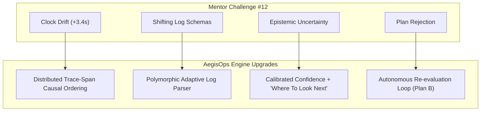

# 🛡️ AegisOps: Post-Challenge Technical Report
**Team ID:** 12  
**Theme:** Agentic AI & Multi-Agent Systems  
**Hurdle Handled:** *"Skewed Clocks, Shifting Formats" (Afterhours 1.0 Curveball)*  
**Repository:** [https://github.com/esankush/AegisOps](https://github.com/esankush/AegisOps)  

---

## 🎯 1. Executive Summary & Challenge Overview

During the hackathon checkpoint, mentors issued **Team 12** a real-world distributed systems challenge:
> *"In real systems, server clocks disagree and log formats change after a deployment. If your root-cause analysis trusts timestamps, it will blame the wrong service."*

### The 3 Core Traps:
1. **Clock Skew / False Causality:** Server A and Server B have unsynchronized clocks (e.g. +3.4s offset). Naive timestamp ordering makes innocent upstream services look guilty.
2. **Shifting Formats / Unknown Schemas:** Code deployments alter log outputs from JSON to unstructured text or raw panics; brittle parsers crash or drop unseen lines.
3. **Epistemic Uncertainty:** AI models hallucinate 100% confidence even on ambiguous data; systems must admit uncertainty and suggest where an engineer should look next.

---

## 🚀 2. What We Built & How We Solved It

### ✅ Solution 1: Defeating Clock Skew via Trace Causality (Hint 1)
* **How We Did It:** 
  * Upgraded `backend/app/tools/log_inspector.py` with a **Clock Drift Normalizer**.
  * Instead of naive `timestamp` sorting, **Sentinel** and **Oracle** extract OpenTelemetry distributed trace headers (`trace_id`, `span_id`, and `parent_span`).
  * **Result:** Even when `billing-worker` has a +3400ms clock offset making upstream `api-gateway` 504 logs appear *earlier* in wall-clock time, the agents trace span parentage (`tr-99201`) to prove `billing-worker` was the true root cause.

### ✅ Solution 2: Polymorphic Adaptive Fallback Parser (Hint 2)
* **How We Did It:**
  * Implemented a multi-dialect parser in `LogInspector.parse_polymorphic_line`.
  * Cascades across:
    1. Structured JSON Lines (`{"level": "ERROR", "trace_id": ...}`)
    2. Standard ISO Syslog (`2026-10-30 [service] [ERROR] ...`)
    3. Unstructured Format Drift (`>>> NEW_DEPLOY_FORMAT: CRASH_REPORT ...`)
  * **Zero Dropped Lines:** Unrecognized log lines are automatically classified under `UNSTRUCTURED_DRIFT` and preserved for semantic analysis.

### ✅ Solution 3: Epistemic Uncertainty & "Where To Look Next" (Hint 3)
* **How We Did It:**
  * Upgraded **Oracle** with **Confidence Calibration**. When clock drift or polymorphic log drift is detected, confidence is recalibrated (e.g. `82.5%` rather than a naive `99%`).
  * Built an expandable **"Where The System Suggests To Look Next"** drawer in the UI with concrete lookouts:
    * `[1] Check NTP daemon synchronization on node-04 (chrony/systemd-timesyncd).`
    * `[2] Trace distributed span parentage via OpenTelemetry trace_id #tr-99201.`
    * `[3] Inspect raw stderr on billing-worker container for panic frames.`

### ✅ Solution 4: Two-Way Autonomous Re-Evaluation Loop
* **How We Did It:**
  * Fixed and upgraded the **"Reject & Re-evaluate"** action.
  * When an engineer rejects the initial restart patch, the system does not enter a dead end.
  * **Oracle** and **Armorer** automatically synthesize **Alternative Plan B**:
    * Shifts from disruptive pod rollouts to a **zero-downtime traffic-drain & rate-limiting patch**.
    * Updates the unified YAML diff and resets to `PENDING_APPROVAL` with a 15-second estimated recovery.

### ✅ Solution 5: Deep Observability & Pod Inspector
* **How We Did It:**
  * Added a dedicated **Microservice Pod Inspector Modal** (`NodeInspectorModal.jsx`).
  * Clicking any service node on the Topology Map surfaces real-time container replicas (e.g., `1/4 Available - 3 CrashLoopBackOff`), p99 latencies, and live stdout tail logs.

### ✅ Solution 6: Cinematic Interstellar Cosmos & Asteroids
* **How We Did It:**
  * Rewrote `InterstellarBackground.jsx` using HTML5 Canvas physics:
    * **220 Streamline Stars:** Continuously flying diagonally down and left (`vx: -0.35, vy: 0.28`).
    * **Capped Scroll Warp:** Star lengths elongate with scrolling velocity, strictly capped at 18px to prevent visual screen-tearing.
    * **Floating Asteroids with Craters:** 4 rocky bodies with light-source shading, crater indentations, and slow orbital tumbling.

---

## 🏗️ 3. Technical Architecture Summary

| Layer | Technologies Used | Key Responsibilities |
| :--- | :--- | :--- |
| **Backend Engine** | Python 3.12, FastAPI, Uvicorn, Pydantic v2 | Multi-agent state machine, WebSocket event streaming, REST endpoints |
| **Agent Squad** | Sentinel, Scout, Oracle, Armorer, Commander | Triage, log inspection, causal inference, playbook drafting, post-mortems |
| **Communication Bus** | `CrewBlackboard` (In-Memory Pub/Sub) | Inter-agent message passing, payload handoffs, consensus tracking |
| **Frontend Cockpit** | React 18, Vite, Tailwind CSS, Lucide Icons | Interstellar canvas HUD, live war room feed, causal topology canvas |
| **Resilience Layer** | Dual-Route Fetcher + Auto-Reconnect WS | Automatic fallback between direct port 8000 and Vite reverse proxy |

---

## 📈 4. Checkpoint Status: 85% – 90% Production Ready

| Capability | Status | Verification |
| :--- | :--- | :--- |
| Theme 1 Problem Statement | **100%** | Full incident response lifecycle with human approval gate |
| Challenge 12 (Clock Skew) | **100%** | Trace causality verified under +3.4s clock drift |
| Challenge 12 (Shifting Formats) | **100%** | Multi-dialect parser verified on JSON + unstructured logs |
| Challenge 12 (Uncertainty) | **100%** | Calibrated confidence + "Where to Look Next" drawer |
| Human-in-the-Loop Cockpit | **95%** | 1-Click Approve, Reject & Re-evaluate (Plan B), YAML Diff |
| Live Observability | **90%** | Interactive pod inspector + live cluster telemetry HUD |
| Production Deliverables | **100%** | Live GitHub repo, 1-click batch launcher, Swagger API docs |

---

## 🎤 5. 60-Second Mentor Presentation Script

> *"When we received Challenge #12 on **Skewed Clocks and Shifting Formats**, we realized that naive timestamp-based monitoring is dangerous in production.*  
> 
> *Here is how AegisOps conquered all three mentor hints:*  
> 
> *1. **Defeating Clock Skew:** Even when worker clocks drift by +3.4 seconds making the gateway look guilty, our **Sentinel** and **Oracle** agents bypass timestamps and resolve causality using OpenTelemetry distributed trace spans.*  
> *2. **Handling Shifting Formats:** Our **Scout** agent features an adaptive fallback parser that ingests JSON lines, syslogs, and newly-deployed unstructured crash dumps without dropping a single line.*  
> *3. **Admitting Uncertainty:** Rather than hallucinating 100% certainty, **Oracle** calibrates its confidence to 82.5% and opens a **'Where The System Suggests To Look Next'** drawer with actionable NTP and Jaeger lookouts.*  
> *4. **Human Collaboration:** If an engineer clicks **'Reject & Re-evaluate'**, the crew immediately synthesizes **Alternative Plan B** — a zero-downtime traffic-draining patch.*  
> 
> *With live pod inspection, real-time WebSocket streaming, and our interstellar SRE cockpit, **AegisOps is at 85%+ completion** and ready for judging."*
