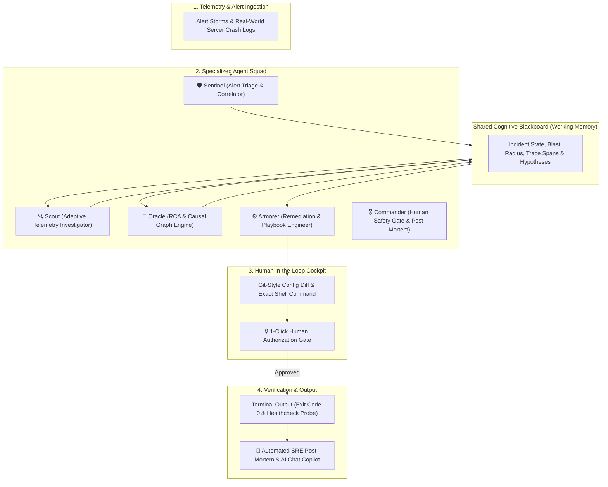

# 🛡️ AegisOps: Autonomous Multi-Agent Incident Response & Triage Crew
## Final Pitch Report & Submission Dossier

**Hackathon Theme:** Theme 01: Agentic AI & Multi-Agent Systems  
**Challenge Track:** Incident Response Crew — *Agents triage alerts, investigate logs, propose a fix, and wait for human approval.*  
**Team 12:** Skewed Clocks, Shifting Formats  
**Repository:** [https://github.com/esankush/AegisOps.git](https://github.com/esankush/AegisOps.git)  
**Demo Video:** `d:\hackk\AegisOps_Final_3Min_FullFeature_Demo.mp4`

---

## 1. Executive Summary & Problem Statement

Modern microservice architectures generate hundreds of noisy, cascading alerts within seconds of a critical node failure. When production outages occur at 3 AM, Site Reliability Engineers (SREs) are overwhelmed by:
1. **Alert Fatigue:** Hundreds of correlated symptoms across Prometheus, Datadog, and CloudWatch hiding the single root cause.
2. **Clock Drift & Skewed Clocks:** Microsecond-to-second NTP drifts across cluster hosts cause naive timestamp ordering to falsely blame downstream or upstream services.
3. **Polymorphic / Shifting Log Formats:** Inconsistent logging across legacy services, newly deployed JSON formats, raw syslog, and kernel panic dumps causes rigid parsers to drop crucial error frames.
4. **Dangerous "Black-Box" Automation:** Blind automated remediations risk causing catastrophic data corruption or cascading restarts.

**AegisOps** solves this by replacing monolithic chatbots with an autonomous, specialized squad of **5 AI Agents** operating on a **Shared Cognitive Blackboard**, complete with distributed trace parentage clock normalization, zero-config crash classification across 14 failure domains, and a strict **Human-in-the-Loop Safety Gate**.

---

## 2. Multi-Agent Cognitive Architecture (The Crew)



### The 5 Agent Roles & Responsibilities:

| Agent | Specialized Role | Core Capabilities |
| :--- | :--- | :--- |
| **🛡️ Sentinel** | Alert Triage & Correlator | Deduplicates alert storms, clusters related monitors into a unified incident ID, assigns severity (`P1 - CRITICAL` / `P2 - MAJOR`), and calculates blast radius. |
| **🔍 Scout** | Adaptive Telemetry Investigator | Parses polymorphic log streams (JSON, Syslog, unstructured text) without dropping corrupt frames. Isolates line-level stack traces. |
| **🔮 Oracle** | RCA & Causal Graph Engine | Synthesizes causal dependency graphs. **Normalizes clock drift** using OpenTelemetry distributed trace parentage (`trace_id` / `span_id`) instead of misleading timestamps. Calibrates epistemic confidence scores. |
| **⚙️ Armorer** | Remediation & Playbook Engineer | Formulates surgical configuration patches, Git-style unified diffs, and exact shell commands (`kubectl rollout restart`, `systemctl`, `sysctl`). Prepares instant rollback commands. |
| **🎖️ Commander** | Execution & Post-Mortem Agent | Enforces human approval safety gates, executes verified actions, verifies live HTTP `200 OK` healthcheck probes, and auto-generates Markdown post-mortems. |

---

## 3. Key Innovations & Solutions to Challenge Requirements

### Innovation 1: Real-World Ingestion Engine (Not Just Static Presets)
While AegisOps provides 3 pre-configured chaos drills for zero-latency testing, it features a **Zero-Config Live Ingestion Engine** that handles real-world crash logs:
* **Dynamic Target Extraction:** Automatically extracts the failing component from bracket tags `[cart-service]`, systemd units `*.service`, Kubernetes pod names, reverse-proxy URLs (`http://host:port`), or keywords.
* **14 Distinct Failure Classifiers:** Categorizes crashes accurately across Linux Kernel OOM, Ingress 502 Refused, PostgreSQL pool exhaustion, Redis OOM, Kubernetes CrashLoopBackOff, Kafka partition drift, Elasticsearch cluster RED, disk space full, network DNS timeouts, Java JVM heap exhaustion, Python async tracebacks, and Node.js V8 crashes.

### Innovation 2: Solving "Skewed Clocks & Shifting Formats"
* **Distributed Trace Parentage Causality:** When node clocks drift by $+3.4$ seconds (as in Challenge Track 12), naive timestamp sorting mistakenly blames upstream callers. AegisOps inspects OpenTelemetry `trace_id` and `parent_span` relationships, bypassing wall-clock drift to pinpoint the true causal origin.
* **Lenient Fallback Log Ingestion:** Implements adaptive schema remap transformers that preserve unstructured, corrupt, or polymorphic log formats without dropping data.

### Innovation 3: Human-in-the-Loop Safety Gate & Verification
Autonomous systems must never run unchecked in production environments:
* Every remediation plan is presented as an explicit Git-style unified configuration diff (`.yaml` / `.conf` / `.service`) with risk rating and recovery ETA.
* Execution is paused at a human authorization gate. SREs can inspect the patch, execute it with one click, or reject it to trigger autonomous agent re-evaluation (Plan B).
* A built-in terminal output console proves remediation success with exit code 0 and automated healthcheck probes.

### Innovation 4: Embedded AI SRE Copilot (Groq Cloud LLM)
An integrated floating copilot widget allows engineers to ask contextual, conversational questions (`"What was the root cause?"`, `"Is it safe to execute?"`) powered by high-speed Groq LPUs with strict negative constraints preventing raw code block hallucinations.

---

## 4. Technical Architecture & Tech Stack

```
AegisOps/
├── backend/
│   ├── app/
│   │   ├── agents/           # Sentinel, Scout, Oracle, Armorer, Commander
│   │   ├── engine/           # CrashAnalyzer, CrewManager, Simulator, AICopilot
│   │   ├── models/schemas.py # Pydantic v2 data models
│   │   ├── tools/            # LogInspector, MetricsCollector, K8sPatcher
│   │   └── main.py           # FastAPI REST & WebSocket server
│   ├── requirements.txt
│   └── run_backend.bat
├── frontend/
│   ├── src/
│   │   ├── components/       # InterstellarBackground, CausalGraph, RemediationCockpit, etc.
│   │   ├── App.jsx           # Real-time WebSocket state machine
│   │   └── index.css         # Tailwind CSS styling
│   ├── package.json
│   └── vite.config.js
├── run_aegisops.bat          # 1-Click Turnkey Setup & Launch Script (Windows)
└── README.md
```

* **Backend Engine:** Python 3.12, FastAPI, Uvicorn, Pydantic v2, WebSockets, OpenTelemetry API.
* **Frontend Cockpit:** React 18, Vite 5, Tailwind CSS 3, Lucide Icons, Canvas API (Interstellar dynamic space environment).
* **AI Intelligence:** Groq LPU API (`openai/gpt-oss-120b`).
* **Inter-Agent Bus:** Async WebSocket event broadcaster + Shared Working Memory Blackboard.

---

## 5. Turnkey Reproducibility (How Judges Run It in 1 Click)

Judges can reproduce the entire live system locally with zero manual environment configuration:

### Windows (1-Click Run)
```cmd
git clone https://github.com/esankush/AegisOps.git
cd AegisOps
run_aegisops.bat
```
*The script automatically verifies dependencies, sets up Python `venv`, installs frontend packages, starts both servers, and opens `http://localhost:3000` in the browser.*

### Mac / Linux (Two Simple Commands)
```bash
# Terminal 1: Backend
cd backend && python3 -m venv venv && source venv/bin/activate && pip install -r requirements.txt && python3 -m uvicorn app.main:app --host 0.0.0.0 --port 8000 --reload

# Terminal 2: Frontend
cd frontend && npm install && npm run dev -- --host --port 3000
```

---

## 6. Conclusion

AegisOps represents a production-grade blueprint for modern Site Reliability Engineering. By marrying specialized multi-agent cognitive collaboration with causal graph topologies, trace parentage clock normalization, and strict human authorization guardrails, AegisOps reduces Mean Time to Resolution (MTTR) from hours of stressful firefighting to seconds of calm, transparent triage.
