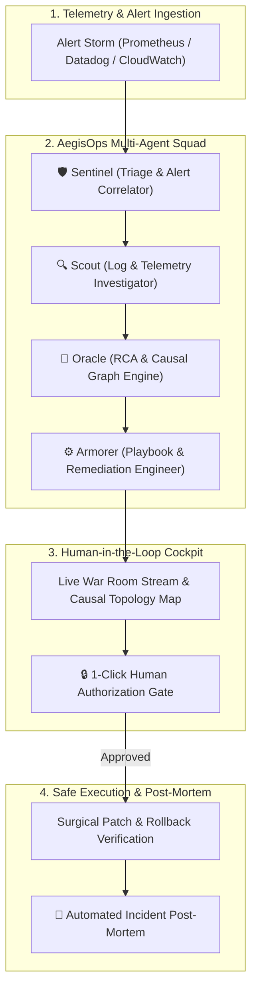

# 🛡️ AegisOps: Autonomous Multi-Agent Incident Response & Triage Crew

> **Theme 01:** Agentic AI & Multi-Agent Systems  
> **Problem Statement:** *Incident response crew — Agents triage alerts, investigate logs, propose a fix, and wait for human approval.*  
> **Built for:** Afterhours 1.0 Hackathon

[](LICENSE)
[](https://fastapi.tiangolo.com/)
[](https://vitejs.dev/)
[](https://tailwindcss.com/)
[](https://python.org)

---

##  Overview

Modern microservice architectures generate hundreds of noisy, cascading alerts within seconds of a critical failure. On-call SREs are woken up at 3 AM to sift through thousands of log lines, correlated APM spans, and cryptic stack traces.

**AegisOps** is an autonomous multi-agent incident response squad that acts in milliseconds:
1. **Clusters & triages noisy alert storms** across Prometheus, Datadog, and CloudWatch.
2. **Investigates telemetry & logs** using specialized agentic tools to isolate anomalous stack traces.
3. **Formulates causal graph hypotheses & RCA** to pinpoint the exact broken commit, memory leak, or deadlock.
4. **Designs surgical remediation playbooks** with unified diffs, risk scoring, and verified rollback guarantees.
5. **Human-in-the-Loop Cockpit**: Pauses at a safety gate requiring 1-click human authorization before applying changes.
6. **Auto-Generates SRE Post-Mortems** in exportable Markdown.

All wrapped in an **Interstellar Cosmic Command Cockpit** featuring dynamic canvas starfields, glowing nebulae, live telemetry HUDs, and real-time WebSocket event streaming.

---

##  The Multi-Agent Squad



### 1.  Sentinel (Triage & Correlator)
- Deduplicates alert storms and correlates disparate monitoring signals into a single unified incident.
- Classifies severity (`P1 - CRITICAL`, `P2 - MAJOR`) and calculates the blast radius.

### 2. Scout (Log & Anomaly Investigator)
- Deep-dives into container logs, traces, and metrics collectors.
- Extracts critical stack traces, out-of-memory errors, and deadlocked threads.

### 3. Oracle (RCA & Hypothesis Engine)
- Synthesizes the causal chain across the microservice topology.
- Formulates high-confidence root-cause explanations (e.g., leaked unclosed JDBC connections, unbounded hash maps).

### 4.  Armorer (Remediation & Playbook Engineer)
- Drafts surgical Kubernetes patches (`kubectl patch configmap`, canary rollbacks).
- Generates Git-style unified configuration diffs, assigns risk scores (`LOW`/`MEDIUM`/`HIGH`), and prepares instant rollbacks.

### 5.  Commander (Human Approval & Post-Mortem Generator)
- Holds execution until an authorized human engineer clicks **"Authorize & Execute"**.
- Verifies cluster pod recovery and auto-generates a Markdown Post-Mortem with preventative action items.

---

##  Built-in Chaos Scenarios (1-Click Demos)


1. **PostgreSQL Connection Pool Exhaustion & Thread Starvation**:
   - *Problem:* Leaked connection in `CheckoutHandler.java` exhausts 1000/1000 Postgres connection slots, causing cascading 500 spikes at the API Gateway.
   - *Remediation:* Kill stale transactions, update Hikari `leakDetectionThreshold` and `maxLifetime`, and rollout restart checkout pods.

2. **Canary Pod OOMKilled Crash Loop**:
   - *Problem:* Canary commit `#e4f9b2` introduces an unbounded in-memory cache, exceeding 1024Mi memory limits and halting RabbitMQ consumption.
   - *Remediation:* Instant canary rollback to stable release `v2.13.9` and re-scale worker replicas.

3. **Cascading 504 Gateway Timeout (Auth Deadlock)**:
   - *Problem:* JWKS rotation thread encounters TCP timeout with internal Vault, holding 200 HTTP worker threads in deadlock.
   - *Remediation:* Inject fallback environment flag `USE_LOCAL_JWKS_CACHE=true` and reduce sync timeout.

---

## Repository Structure

```
d:\hackk\
├── backend/
│   ├── app/
│   │   ├── agents/
│   │   │   ├── sentinel.py       # Triage & Alert Correlator Agent
│   │   │   ├── scout.py          # Log & Anomaly Investigator Agent
│   │   │   ├── oracle.py         # RCA & Causal Hypothesis Agent
│   │   │   ├── armorer.py        # Playbook & Remediation Agent
│   │   │   └── commander.py      # Execution & Post-Mortem Agent
│   │   ├── engine/
│   │   │   ├── simulator.py      # Chaos scenarios & synthetic incidents
│   │   │   └── crew_manager.py   # Async event loop & WebSocket broadcaster
│   │   ├── models/
│   │   │   └── schemas.py        # Incident, Alert, Thought schemas
│   │   ├── tools/
│   │   │   ├── log_inspector.py  # Log analysis & stacktrace extraction
│   │   │   ├── metrics_collector.py # CPU, RAM, latency metrics
│   │   │   └── k8s_patcher.py    # Cluster patch & rollback execution
│   │   ├── config.py             # Settings & API keys
│   │   └── main.py               # FastAPI server & WebSocket endpoint
│   ├── requirements.txt
│   ├── run_backend.bat
│   └── test_backend.py
├── frontend/
│   ├── src/
│   │   ├── components/
│   │   │   ├── InterstellarBackground.jsx # HTML5 Canvas stars, nebulae & shooting stars
│   │   │   ├── Header.jsx                 # Chaos trigger & telemetry status
│   │   │   ├── IncidentHeader.jsx         # Severity, ID, blast radius HUD
│   │   │   ├── AgentCrewPanel.jsx         # Sentinel, Scout, Oracle, Armorer status
│   │   │   ├── LiveWarRoom.jsx            # Real-time streaming conversation log
│   │   │   ├── CausalGraph.jsx            # Microservice topology & blast radius map
│   │   │   ├── RemediationCockpit.jsx     # Diff viewer & Human-in-the-loop gate
│   │   │   ├── TelemetryHUD.jsx           # Real-time CPU, RAM, p99 latency gauges
│   │   │   └── PostMortemModal.jsx        # Markdown report viewer & download
│   │   ├── App.jsx
│   │   ├── index.css
│   │   └── main.jsx
│   ├── package.json
│   ├── tailwind.config.js
│   └── vite.config.js
├── run_aegisops.bat                      # 1-Click launcher for Backend + Frontend
└── README.md
```

---

##  Quickstart Guide

### Option 1: 1-Click Launch (Windows)
Double-click `run_aegisops.bat` in the root folder, or execute:
```cmd
run_aegisops.bat
```
This automatically starts:
- **Backend Engine:** `http://localhost:8000` (Swagger docs at `/docs`)
- **Interstellar War Room:** `http://localhost:3000`

---

### Option 2: Manual Start

#### 1. Backend (FastAPI + Python 3.12)
```powershell
cd backend
python -m venv venv
venv\Scripts\activate
pip install -r requirements.txt
uvicorn app.main:app --host 0.0.0.0 --port 8000 --reload
```

#### 2. Frontend (React + Vite + Tailwind)
```powershell
cd frontend
npm install
npm run dev
```


---


```powershell
# Set your git identity (if not already set)
git config --global user.name "Your Name"
git config --global user.email "your.email@example.com"

# Stage all files and create the initial commit
git add .
git commit -m "feat: initial commit of AegisOps Autonomous Multi-Agent Incident Response Crew"

# Add your GitHub remote repository (replace with your repo URL)
git branch -M main
git remote add origin https://github.com/<YOUR-USERNAME>/<YOUR-REPO-NAME>.git

# Push the repository
git push -u origin main
```

---

KEY DIFFERENCES

-  **Theme 01: Agentic AI & Multi-Agent Systems** ("Incident response crew: Agents triage alerts, investigate logs, propose a fix and wait for human approval").
- **True Multi-Agent Collaboration:** Distinct specialized roles with independent tool sets rather than a monolithic chatbot.
- **Human-in-the-Loop Safety:** Autonomous triage and root-cause analysis, but gated execution with unified diff inspections and rollback mechanisms.
- **Interstellar Cosmic UX:** Cinematic dark-mode SRE command center with canvas starfields, shooting stars, and glassmorphic telemetry cards.
- **Deterministic Live Demo:** 3 pre-configured incident simulations for zero-latency, error-free judging demonstrations.
