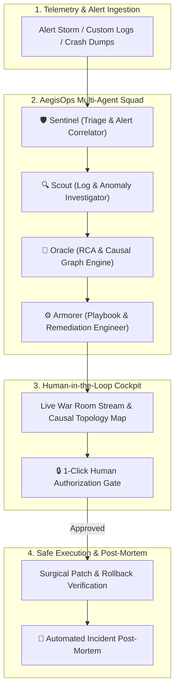

# 🛡️ AegisOps: Autonomous Multi-Agent Incident Response & Triage Crew

> **Theme 01:** Agentic AI & Multi-Agent Systems  
> **Problem Statement:** *Incident response crew — Agents triage alerts, investigate logs, propose a fix, and wait for human approval.*  
> **Team:** Skewed Clocks, Shifting Formats (Team 12)  
> **Built for:** Afterhours 1.0 Hackathon

[](LICENSE)
[](https://fastapi.tiangolo.com/)
[](https://vitejs.dev/)
[](https://tailwindcss.com/)
[](https://python.org)

---

## 🚀 Quick Start (Judges — Run in 1 Click)

### Prerequisites
- **Python 3.10+** ([python.org](https://python.org))
- **Node.js 18+** ([nodejs.org](https://nodejs.org))
- **Git** (to clone the repo)

### Step 1: Clone & Run

```bash
git clone https://github.com/esankush/AegisOps.git
cd AegisOps
```

**On Windows — Double-click `run_aegisops.bat`** or run:
```cmd
run_aegisops.bat
```

This will **automatically**:
1. Create a Python virtual environment and install dependencies
2. Install frontend npm packages
3. Start the Backend API on **http://localhost:8000**
4. Start the War Room UI on **http://localhost:3000**
5. Open the browser

> **That's it.** The website opens automatically. No manual config needed.

---

### Manual Start (if the bat file doesn't work)

**Terminal 1 — Backend:**
```powershell
cd backend
python -m venv venv
venv\Scripts\activate        # On Mac/Linux: source venv/bin/activate
pip install -r requirements.txt
python -m uvicorn app.main:app --host 0.0.0.0 --port 8000 --reload
```

**Terminal 2 — Frontend:**
```powershell
cd frontend
npm install
npm run dev -- --host --port 3000
```

Then open **http://localhost:3000** in your browser.

---

## 📋 How to Use (Demo Walkthrough)

### Option A: Pre-Built Chaos Scenarios (Top Header Dropdown)
1. Select a scenario from the **dropdown** in the top header (e.g., "PostgreSQL Pool Exhaustion")
2. Click **"Trigger Chaos Scenario"**
3. Watch the 4 AI agents work through the pipeline in real-time

### Option B: Paste Any Error Logs (The Real Power)
1. Click the **"📋 Paste Error Logs"** button in the top header
2. You'll see 3 input fields at the top:
   - **Incident Title** — Give it a name (auto-filled as you paste logs)
   - **Target Microservice** — Which system broke (auto-detected from logs)
   - **Error Logs** — Paste any crash logs, stack traces, or even random text
3. Click **"Analyze & Deploy Triage"**

**You can paste literally anything:**
- Linux kernel OOM dumps (`dmesg` output)
- Nginx 502 error logs
- PostgreSQL connection errors
- Java/Python/Node.js stack traces
- Kafka broker failures
- Disk full errors
- Network connection resets
- Or even plain English like "our checkout is down"

Each different input produces a **unique** incident with different targets, topology graphs, failure classes, and remediation commands.

### Option C: Click a Pre-Built Crash Preset
Inside the paste modal, there are 7 clickable crash preset buttons (Linux OOM, Nginx 502, Postgres, K8s CrashLoop, Kafka, Python Traceback, Custom Drift) that auto-fill real-world logs instantly.

---

## 🔍 Where to See the Solution

After submitting logs, the solution appears across these panels (scroll down):

| Panel | What It Shows |
|-------|---------------|
| **Incident Header** (top) | Title, severity badge, blast radius, root cause summary, "Where to Look Next" commands |
| **Agent Crew Cards** | 4 AI agents each explain their findings — Oracle shows the root cause hypothesis |
| **Live War Room** | Real-time terminal stream of agent conversation |
| **Causal Topology Graph** | Visual map showing which microservice failed and the crash propagation path |
| **⭐ Remediation Cockpit** (bottom) | **THE ACTUAL FIX**: exact shell commands, git-style config diff, risk level, recovery time, rollback plan |
| **AI Copilot Chat** (bottom-right bubble) | Ask follow-up questions about the incident (powered by Groq LLM) |

### The Fix Flow:
1. **Paste logs** → auto-detects problem & target
2. **4 agents analyze** → root cause identified
3. **Remediation Cockpit** shows the fix command + config patch
4. Click **"Authorize & Execute"** to apply (or **"Reject"** for an alternative plan)
5. **Terminal output** shows execution result with healthcheck verification
6. **Post-Mortem report** auto-generates after resolution

---

## 🏗️ Architecture



### Multi-Agent Roles

| Agent | Role | What It Does |
|-------|------|-------------|
| 🛡️ **Sentinel** | Triage & Correlator | Deduplicates alert storms, classifies severity, calculates blast radius |
| 🔍 **Scout** | Log Investigator | Deep-dives into logs, extracts stack traces, handles polymorphic log formats |
| 🔮 **Oracle** | RCA Hypothesis Engine | Builds causal dependency graph, identifies root cause with confidence % |
| ⚙️ **Armorer** | Remediation Engineer | Writes surgical fix commands, git-style config diffs, risk scores, rollback plans |
| 🎖️ **Commander** | Execution & Post-Mortem | Executes approved fix, verifies healthchecks, generates markdown post-mortem |

---

## 🔧 Dynamic Crash Detection Engine

AegisOps doesn't use a fixed lookup table. It has a **real-time crash classification engine** that recognizes 14+ failure domains:

| Domain | Example Trigger | Auto-Detected Target |
|--------|----------------|---------------------|
| Linux Kernel OOM | `Out of memory: Kill process 18429 (mysqld)` | `mysqld` |
| Nginx 502 | `connect() failed (111: Connection refused)` | upstream app name |
| PostgreSQL | `FATAL: remaining connection slots are reserved` | `postgresql-primary` |
| Redis OOM | `OOM command not allowed when used memory > maxmemory` | `redis-cluster` |
| K8s CrashLoop | `Container terminated with exit code 137 (OOMKilled)` | pod name |
| Kafka Broker | `LeaderNotAvailableException` | broker node |
| Elasticsearch | `cluster_block_exception`, unassigned shards | data node |
| Disk Exhaustion | `No space left on device` | affected host |
| Network / DNS | `ECONNRESET`, `name resolution failed` | socket target |
| Systemd Crash | `Main process exited, code=dumped` | systemd unit |
| Java JVM | `NullPointerException`, `OutOfMemoryError: Java heap` | Spring service |
| Python | `Traceback (most recent call last)` | Python worker |
| Node.js V8 | `JavaScript heap out of memory` | Node.js process |
| **Any Custom Text** | Any arbitrary input | Dynamically extracted service name |

For **any** input that doesn't match the above, AegisOps dynamically extracts a target service name from brackets `[service-name]`, systemd units `*.service`, Kubernetes pod names, URL hostnames, hyphenated slugs, or infrastructure keywords — and builds a complete incident with unique topology, commands, and diffs for that exact target.

---

## 🤖 AI Copilot Chat

A floating chat widget (bottom-right corner) lets you ask follow-up questions about any active incident. Powered by **Groq LLM**.

> To enable: Add your Groq API key to `backend/.env`:
> ```
> GROQ_API_KEY=gsk_your_key_here
> ```
> The chatbot works without it too — it just won't have AI responses.

---

## 📁 Project Structure

```
AegisOps/
├── backend/
│   ├── app/
│   │   ├── agents/           # 5 specialized AI agents
│   │   │   ├── sentinel.py   # Triage & Alert Correlator
│   │   │   ├── scout.py      # Log & Anomaly Investigator
│   │   │   ├── oracle.py     # RCA & Causal Hypothesis
│   │   │   ├── armorer.py    # Playbook & Remediation
│   │   │   └── commander.py  # Execution & Post-Mortem
│   │   ├── engine/
│   │   │   ├── crash_analyzer.py  # Dynamic 14+ domain crash classifier
│   │   │   ├── crew_manager.py    # Async multi-agent orchestrator & WebSocket
│   │   │   ├── simulator.py       # Pre-built chaos scenarios
│   │   │   └── ai_copilot.py      # Groq LLM chat integration
│   │   ├── models/schemas.py      # Pydantic data models
│   │   ├── tools/                 # Agent tool library
│   │   └── main.py               # FastAPI server & REST/WS endpoints
│   ├── requirements.txt
│   └── .env                       # API keys (git-ignored)
├── frontend/
│   ├── src/
│   │   ├── components/
│   │   │   ├── InterstellarBackground.jsx  # Canvas starfield & nebulae
│   │   │   ├── CustomLogModal.jsx          # Log paste & dynamic detection
│   │   │   ├── IncidentHeader.jsx          # Severity, blast radius, RCA
│   │   │   ├── AgentCrewPanel.jsx          # Agent thinking cards
│   │   │   ├── LiveWarRoom.jsx             # Real-time agent stream
│   │   │   ├── CausalGraph.jsx             # Service topology map
│   │   │   ├── RemediationCockpit.jsx      # Fix commands & approval gate
│   │   │   ├── TelemetryHUD.jsx            # CPU, RAM, latency gauges
│   │   │   ├── PostMortemModal.jsx         # Markdown post-mortem
│   │   │   └── AIChatCopilot.jsx           # Groq-powered chat widget
│   │   ├── App.jsx
│   │   └── main.jsx
│   ├── package.json
│   └── vite.config.js
├── run_aegisops.bat                # 1-Click setup + launch (Windows)
└── README.md
```

---

## 🛠️ Tech Stack

| Layer | Technology |
|-------|-----------|
| **Backend** | Python 3.12, FastAPI, Uvicorn, Pydantic v2, WebSockets |
| **Frontend** | React 18, Vite 5, Tailwind CSS 3, Lucide Icons |
| **AI Chat** | Groq LPU Cloud (LLM API) |
| **Real-time** | Native WebSocket event streaming |
| **Architecture** | Multi-Agent Cognitive Pipeline with Shared Blackboard |

---

## ✨ Key Differentiators

- **True Multi-Agent Collaboration:** 5 distinct specialized roles with independent tool sets — not a monolithic chatbot
- **Works on ANY Input:** Paste real kernel dumps, production stack traces, or random text — every input gets a unique, tailored incident
- **Dynamic Target Extraction:** Automatically identifies the failing service from log brackets, systemd units, K8s pods, URLs, or keywords
- **Human-in-the-Loop Safety:** Autonomous analysis but gated execution with diff inspection and instant rollback
- **14+ Failure Domain Classifiers:** Linux OOM, Nginx, PostgreSQL, Redis, K8s, Kafka, Elasticsearch, Disk, Network, Systemd, Java, Python, Node.js, and custom
- **Interstellar Cosmic UX:** Cinematic dark-mode SRE command center with HTML5 Canvas starfields and glassmorphic panels
- **Real-time WebSocket Streaming:** Live agent-to-agent conversation visible in the War Room as it happens
